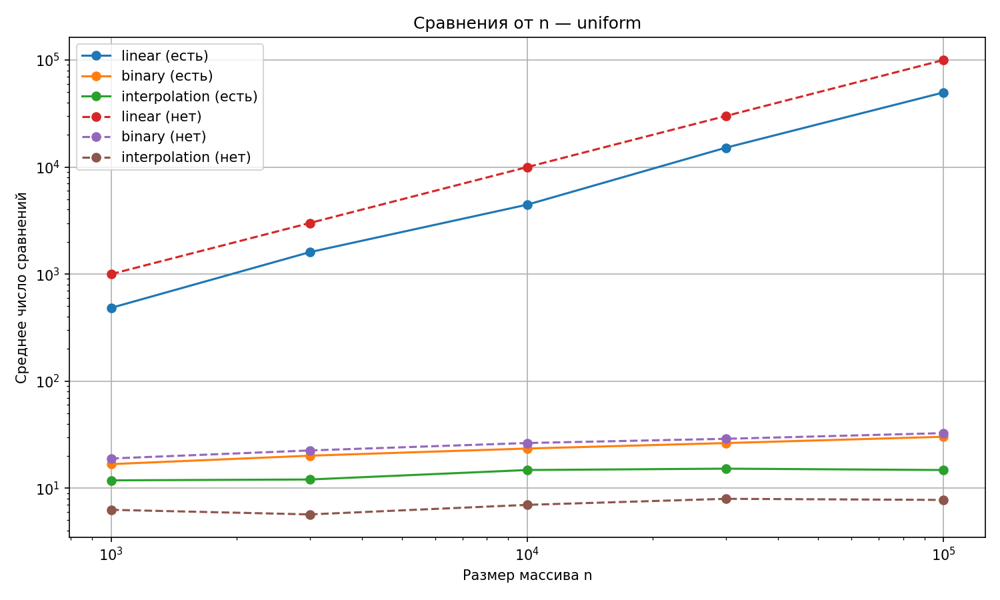
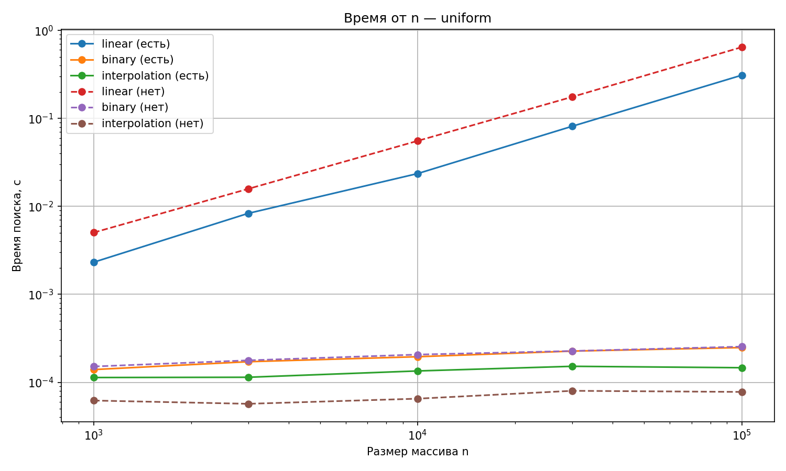
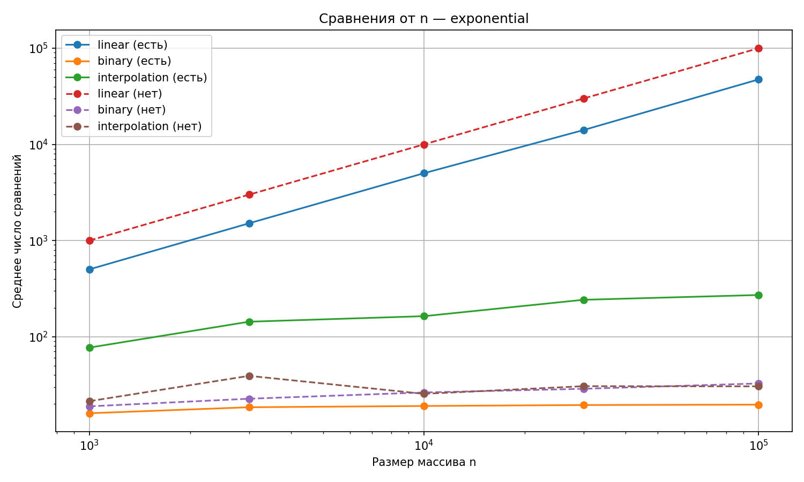
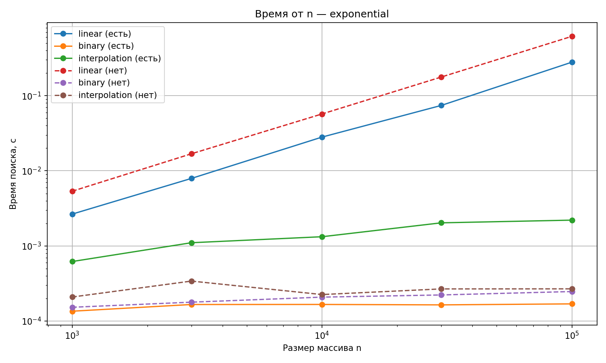

# Лабораторная работа №6
## Линейный, бинарный и интерполяционный поиск: сравнение

**Вариант:** 3  
**Seed:** 33  
**Язык:** Python

### 1. Реализация алгоритмов поиска

В работе реализованы три алгоритма поиска в отсортированном массиве.

- `linear_search()` — последовательно проверяет элементы слева направо.
- `binary_search()` — на каждом шаге делит область поиска пополам, используя границы `lo` и `hi`.
- `interpolation_search()` — вычисляет предполагаемую позицию ключа по формуле интерполяции.

Каждая функция возвращает индекс найденного элемента или `-1`, а также количество выполненных сравнений ключей.

В бинарном поиске поддерживается инвариант границ: искомый элемент, если он существует, остаётся внутри текущего отрезка. В интерполяционном поиске предусмотрена защита от деления на ноль при одинаковых крайних элементах массива.

### 2. Генерация данных

Для эксперимента использован вариант №3 с `seed = 33`.

С помощью `make_dataset()` сформированы отсортированные массивы двух распределений:

- `uniform` — равномерное;
- `exponential` — экспоненциальное, с концентрацией значений около нуля.

Проверены размеры `1000`, `3000`, `10000`, `30000`, `100000` элементов.

Функция `pick_keys()` формирует наборы присутствующих и отсутствующих ключей.

### 3. Экспериментальное сравнение

Для каждого размера массива и распределения проводились серии из 200 поисковых запросов.

Измерялось среднее число сравнений на один поиск и время выполнения серии. Для времени использованы прогрев, пять повторов и медиана.

**Пример результатов при n = 10000, поиск присутствующих ключей:**

| Распределение | Алгоритм | Сравнений | Время, с |
|---|---|---:|---:|
| Равномерное | Линейный | 4454,5 | 0,025704 |
| Равномерное | Бинарный | 23,4 | 0,000203 |
| Равномерное | Интерполяционный | 14,8 | 0,000134 |
| Экспоненциальное | Линейный | 5013,1 | 0,028100 |
| Экспоненциальное | Бинарный | 19,0 | 0,000167 |
| Экспоненциальное | Интерполяционный | 163,4 | 0,001327 |

**Графики равномерного распределения:**

**Графики экспоненциального распределения:**

### 4. Верификация алгоритмов

Для проверки использована функция `self_check()` из стартовой заготовки.

Проверены пустой массив, массив из одного элемента, поиск первого и последнего элементов, отсутствие ключа и массивы с повторяющимися значениями.

Также проведены 300 случайных проверок со сравнением результатов с `in`, `list.index` и `bisect.bisect_left`.

**Результат: `self_check: OK`.**

Все предусмотренные проверки пройдены.

### 5. Анализ результатов и сложности

**Линейный поиск — O(n).** Количество сравнений растёт вместе с размером массива, поскольку элементы проверяются последовательно.

**Бинарный поиск — O(log n).** На каждом шаге область поиска сокращается примерно вдвое. На обоих распределениях количество сравнений оставалось небольшим.

**Интерполяционный поиск — в среднем O(log log n) на равномерно распределённых данных.** Благодаря вычислению предполагаемой позиции он часто находит ключ быстрее бинарного поиска.

На равномерных данных при `n = 10000` интерполяционный поиск выполнил в среднем 14,8 сравнения против 23,4 у бинарного.

На экспоненциальном распределении значения распределены неравномерно, поэтому вычисленная позиция часто оказывается неудачной. При `n = 100000` для присутствующих ключей интерполяционный поиск выполнил 271,2 сравнения против 19,6 у бинарного.

В худшем случае сложность интерполяционного поиска может достигать **O(n)**.

Для отсутствующих ключей результаты отличаются, поскольку реализация интерполяционного поиска может сразу исключить значение, находящееся вне текущего диапазона.

### Вывод

В лабораторной работе реализованы линейный, бинарный и интерполяционный алгоритмы поиска. Проведены проверки корректности и сравнение производительности на двух распределениях данных.

Линейный поиск оказался самым затратным при больших размерах массивов.

Бинарный поиск показал устойчивые результаты на обоих распределениях.

Интерполяционный поиск эффективен на равномерных данных, однако на неравномерных данных может выполнять значительно больше сравнений.

Таким образом, выбор алгоритма поиска зависит не только от размера массива, но и от распределения его элементов.